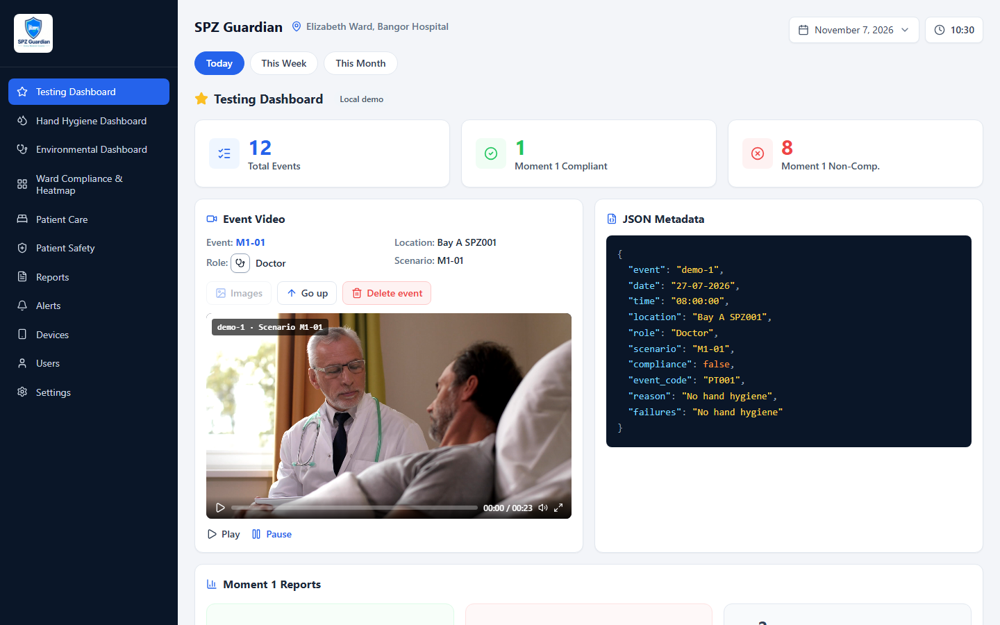
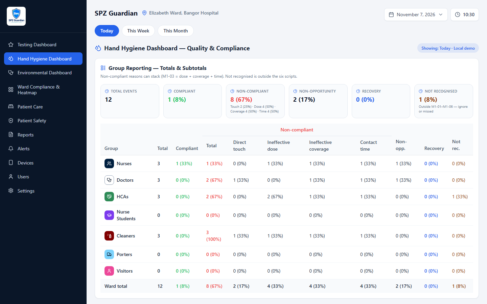
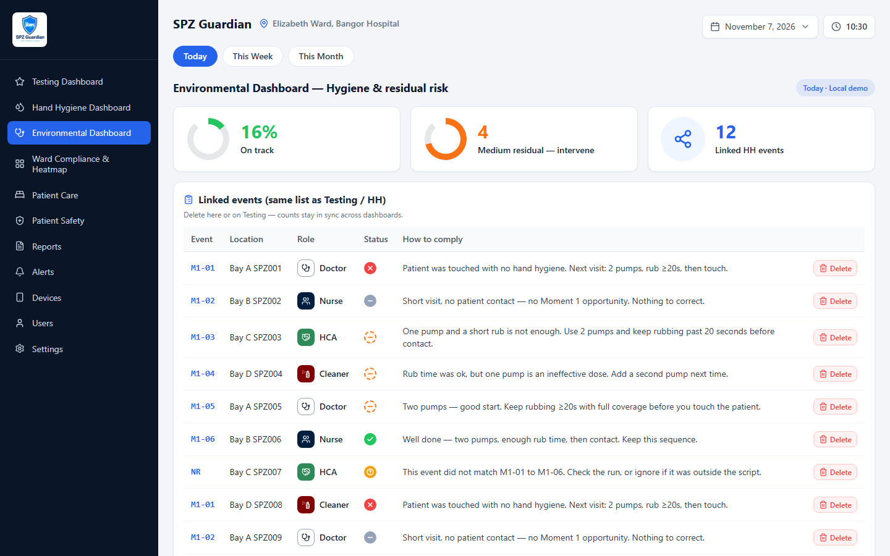
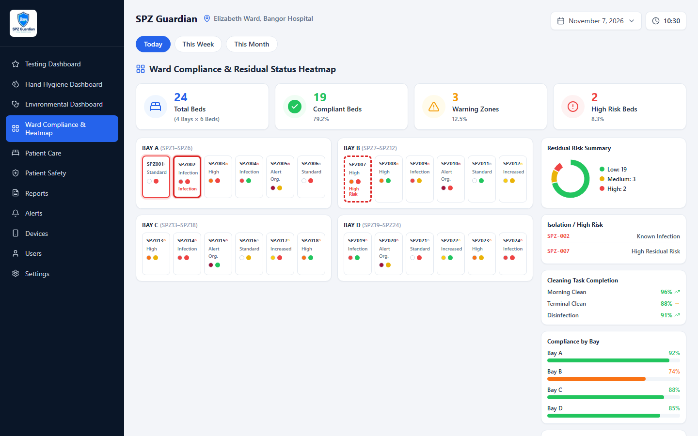

# SPZ Guardian

**Python WHO Moment 1 classifier plus a hospital ward dashboard for hand hygiene, environmental hygiene, and testing.**

Internal operations product for a UK healthcare trial (SMART Patient Zone). Built end-to-end: React dashboard, FastAPI backend, live ward-event feed, and password-gated deployment.

## Screenshots

<p align="center">
  
</p>
<p align="center"><em>Testing Dashboard — WHO Moment 1 events, stats, snapshots, and shared delete</em></p>

<p align="center">
  
</p>
<p align="center"><em>Hand Hygiene — missed opportunity vs quality shortfall by ward, bay, and SPZ</em></p>

<p align="center">
  
</p>
<p align="center"><em>Environmental — shared devices, high-touch surfaces, residual risk</em></p>

<p align="center">
  
</p>
<p align="center"><em>Ward compliance heatmap</em></p>

## Problem

Ward teams need one screen that answers:

- Did this visit create a **Moment 1 opportunity**?
- Was it **compliant**, **non-compliant**, or **not an opportunity**?
- If it failed, **why** — missed opportunity vs quality shortfall (dose / coverage / contact time)?
- Does deleting an event on Testing also update Hand Hygiene and Environmental?

SPZ Guardian turns session JSON (`started_at`, location, role, outcome cues) into reporting the ward can actually use.

## Features

| Area | What it does |
| --- | --- |
| **Testing Dashboard** | Live or demo events, WHO Moment 1 buckets, snapshots, Images / Go up / Delete |
| **Hand Hygiene** | Missed opportunity vs quality shortfall by ward, bay, and SPZ; how to comply |
| **Environmental** | Shared-device, high-touch, reusable vs disposable, residual-risk markers |
| **Heatmap / care / safety** | Ward layout, patient-care tasks, safety and device views |
| **Live feed** | Polls ward `/events` + `/results`; falls back to local demo if the tunnel is down |
| **Shared delete** | One hide/delete path across Testing, HH, and Environmental |
| **POC scripts** | Workbook order M1-01 … M1-06; unmatched runs go to **Not recognised** |

## WHO Moment 1 classifier (Python)

Two layers:

1. **Rules** (`backend/app/classify.py`) — WHO Moment 1 protocol. Features: touch count, dispenser presses, rub seconds, dwell. Output: **M1-01 … M1-06** or **Not recognised**.
2. **Sklearn Decision Tree** (`backend/app/ml_model.py`, `backend/models/moment1_tree.joblib`) — supervised baseline on protocol-labeled sessions (held-out accuracy 1.0 on that synthetic split; it recovered the rule set). Feature importance: dispenser presses, then rub time, then touch.

The React dashboard is still in `frontend/`. It was not removed.

```bash
cd backend
pytest tests/test_classify.py tests/test_ml_model.py
```

`POST /v1/classify` returns `{ features, rules, model }`.

## Tech stack

**Python 3.12:** FastAPI, scikit-learn Decision Tree, joblib, Pytest  
**Dashboard UI:** React 19, Vite 8, Tailwind CSS, Recharts (still in this repo)  
**Integration:** live ward `/events` + `/results`, Vite proxy, static IONOS build

## Architecture

```text
Ward camera / detection PC
        │  Cloudflare tunnel
        ▼
https://www.spzguardian-dash.com  →  /events  /results
        │
        ▼
React dashboard (password gate)
  Testing  │  Hand Hygiene  │  Environmental
        │
        └── shared event list + hide/delete store

FastAPI  /v1/*   (auth, testing, HH, env, heatmap, ingest, reports)
```

Live sessions are classified from outcome fields (touch, interaction, rub time, dwell) into Moment 1 scripts. Display codes stay `M1-xx`; unique keys are `sessionId` so one delete cannot hide a sibling row.

## Repository layout

```text
spz-guardian/
├── frontend/     Vite + React dashboard
│   └── src/pages, src/data, src/components
└── backend/      FastAPI app
    ├── app/routers, app/data
    └── tests
```

## Run locally

### Frontend

```bash
cd frontend
cp .env.example .env.local
npm install
npm run dev
```

Open [http://localhost:5173](http://localhost:5173). Set `VITE_DASHBOARD_PASSWORD` and `VITE_LIVE_ORIGIN` in `.env.local`.

### Backend

```bash
cd backend
python -m venv .venv
.venv\Scripts\activate
pip install -r requirements.txt
cp .env.example .env
uvicorn app.main:app --reload --app-dir .
```

Health check: [http://localhost:8000/health](http://localhost:8000/health)

### Tests

```bash
cd frontend && npm test
cd backend && pytest
```

Do not commit `.env` or `.env.local`.

## API (prefix `/v1`)

`POST /v1/classify` (session → M1 code), plus testing events, hand hygiene, environmental, heatmap, patient care/safety, reports, alerts, devices, users, settings, ingest.

## Role

Designed, implemented, and iterated the dashboard as a solo full-stack build: UI, live mapping, WHO classification, reporting, and FastAPI surface — then deployed the static frontend for ward review.

## License

Source is published for academic review. Product name and trial context belong to the commissioning healthcare programme.
